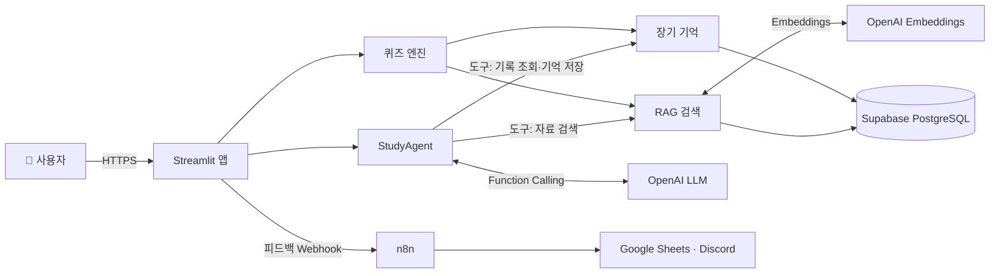

# 📚 StudyMate AI — 내 공부 자료로 질문·퀴즈·복습하는 AI 학습 튜터

> 강의 PDF·필기 노트를 올리면 **자료를 근거로 출처까지 붙여 답하고**, 퀴즈로 **약점을 찾아 기억했다가** 다음 학습에서 먼저 챙겨 주는 AI 튜터 Agent

**🔗 배포 URL**: [https://<앱주소>.streamlit.app](https://<앱주소>.streamlit.app) · **🎬 시연 영상**: [YouTube 링크] · **📑 발표 자료**: [`docs/presentation.pdf`](docs/presentation.pdf)

---

## 프로젝트 소개

범용 AI 챗봇은 **내 수업 자료를 모르고**, 출처 없이 그럴듯한 오답을 섞으며, **어제 내가 뭘 틀렸는지 기억하지 못합니다.**
StudyMate AI는 이 세 가지 문제를 각각 **RAG · AI Agent · Long-term Memory**로 해결합니다.

```
① 자료 올리기 → ② AI 튜터에게 질문 → ③ 퀴즈로 확인 → ④ 약점 기억 → ⑤ 다음 대화에서 먼저 챙김
  PDF·TXT·MD     자료 근거 + 출처 [S1]    자료 기반 객관식      자동 갱신            개인화 설명·재출제
```

| 주요 기능 | 설명 |
|---|---|
| 💬 AI 튜터 | Agent가 질문 의도에 맞춰 도구(자료 검색·학습 기록 조회·기억 저장)를 골라 실행, 근거 문장마다 [S1] 출처 표시 |
| 📚 내 자료 | PDF·TXT·MD 업로드 → 페이지별 청크·임베딩. 전화번호·이메일·주민번호 자동 마스킹. 샘플 자료로 바로 체험 |
| 📝 퀴즈 | 범위·주제·난이도·문항 수 선택, 자료 기반 객관식 생성·채점·해설·근거, 약점 집중 출제, 틀린 개념 다시 배우기 |
| 🧠 학습 기록 | AI가 기억한 목표·선호·약점·강점 확인·삭제·추가, 정답률 추이, 데이터 전체 삭제 |
| 🗣️ 피드백 | 답변별 👍👎, 설문(버전 자동 기록), n8n으로 시트·Discord 자동 전달 |
| 🔧 관리자 | 사용자 테스트 현황, 버전별 만족도 비교, 피드백 CSV, 👎 답변 분석 |

## 팀원 및 역할

| 이름 | 역할 | 담당 업무 |
|---|---|---|
| [이름] | PM / 기획 | 일정·이슈 관리, 문제 정의·인터뷰, 사용자 테스트 총괄, 발표 |
| [이름] | AI Engineer | Agent 루프·도구, 프롬프트 엔지니어링, 장기 기억 (`agent.py`, `prompts.py`, `memory.py`) |
| [이름] | RAG / Data | 문서 처리·임베딩·검색, 퀴즈 생성, 검색 품질 평가 (`documents.py`, `rag.py`, `quiz.py`) |
| [이름] | Frontend / UX | Streamlit 화면, 사용 흐름·문구, 피드백·관리자 화면 (`app.py`, `texts.py`) |
| [이름] | DevOps / QA | DB·배포·Secrets, 테스트·CI, n8n 자동화, 개인정보 보호 (`db.py`, `analytics.py`, `tests/`) |

## 기술 스택

- **AI**: OpenAI API (`gpt-5.4-mini` — Function Calling·JSON 출력, `text-embedding-3-small`)
- **Agent**: OpenAI Function Calling 기반 도구 사용 루프 직접 구현 (프레임워크 없음)
- **RAG**: pypdf 추출 → 800자/150자 겹침 청크 → 임베딩 → numpy 코사인 유사도 검색
- **App**: Python 3.12, Streamlit
- **DB**: Supabase PostgreSQL (배포) / SQLite (로컬) — `DATABASE_URL`로 전환
- **Infra**: Streamlit Community Cloud, GitHub Actions (CI)
- **자동화**: n8n (피드백 → Google Sheets + Discord 알림)
- **품질**: pytest 57개 (가짜 LLM으로 API 비용 없이 전체 흐름 검증)

선정 이유: [`docs/04_기술스택_및_의사결정.md`](docs/04_기술스택_및_의사결정.md)

## 시스템 아키텍처



상세 구성도·시퀀스·ERD: [`docs/02_요구사항_명세서.md`](docs/02_요구사항_명세서.md)

## 핵심 AI 활용

### 1. AI Agent — 도구를 스스로 고르는 튜터
| 도구 | 언제 | 하는 일 |
|---|---|---|
| `search_study_materials` | 학습 내용 질문 | 내 자료에서 근거 청크 검색 → [S1]~[S4] |
| `get_learner_profile` | "내 약점?", "복습 추천" | 기억·퀴즈 이력 조회 |
| `save_learner_memory` | 목표·선호·약점을 들었을 때 | 장기 기억 저장 ("🧠 기억했어요" 알림) |

최대 5단계 루프, 도구 오류는 LLM에 돌려줘 스스로 복구, 답변에 실제 인용된 출처만 '인용'으로 표시.

### 2. RAG — 내 자료를 근거로, 출처까지
- 페이지별 추출 → 개인정보 마스킹 → 800자 청크(150자 겹침) → 임베딩을 DB에 저장
- 질문 임베딩과 코사인 유사도 Top-4(최소 0.2) → 사용자별 격리 검색
- 자료에 없으면 "찾지 못했어요" + 보충 설명은 "(일반 지식)" 표시

### 3. Long-term Memory — 나를 기억하는 튜터
- 목표·선호·약점·강점·기타 5종을 DB에 저장, **매 대화 시스템 프롬프트에 자동 주입**
- 퀴즈 오답 → 약점 +1, 다시 맞히면 -1 → 0이 되면 "복습으로 극복" 강점으로 전환
- 사용자가 직접 확인·삭제·추가 가능

### 4. 자동화 워크플로우 (n8n)
피드백 제출 → DB 저장 → Webhook → Google Sheets 기록 + Discord 팀 알림 (외부엔 익명 ID만 전송)

상세 설계·프롬프트 근거: [`docs/03_AI_설계서.md`](docs/03_AI_설계서.md)

## 실행 방법

### 요구사항
- Python 3.10 이상 (3.12 권장)
- OpenAI API 키

### 설치 및 실행
```bash
git clone https://github.com/<아이디>/studymate-ai.git
cd studymate-ai
python -m venv .venv
source .venv/bin/activate            # Windows: .venv\Scripts\activate
pip install -r requirements-dev.txt
cp .env.example .env                 # Windows: copy .env.example .env  → OPENAI_API_KEY 입력
pytest -q                            # 57 passed
streamlit run app.py                 # http://localhost:8501
```

### 배포
Streamlit Community Cloud + Supabase — 단계별 안내: [`docs/08_작업_순서_가이드.md`](docs/08_작업_순서_가이드.md)

### 주요 설정 (환경 변수 / Streamlit Secrets)
| 이름 | 기본값 | 설명 |
|---|---|---|
| `OPENAI_API_KEY` | — | 필수 |
| `CHAT_MODEL` / `EMBEDDING_MODEL` | `gpt-5.4-mini` / `text-embedding-3-small` | 모델 교체 |
| `REASONING_EFFORT` | `low` | 비추론 모델은 `off` |
| `DATABASE_URL` | `sqlite:///data/studymate.db` | 배포 시 Supabase pooler URI |
| `ADMIN_PASSWORD` | — | 관리자 화면 |
| `N8N_WEBHOOK_URL` / `FEEDBACK_FORM_URL` | — | 선택 |
| `DAILY_MESSAGE_LIMIT` | `100` | 1인 하루 질문 한도 |
| `RETRIEVAL_TOP_K` / `RETRIEVAL_MIN_SCORE` | `4` / `0.2` | 검색 튜닝 |

## 프로젝트 구조
```
studymate-ai/
├── app.py                    # Streamlit 화면·라우팅
├── studymate/
│   ├── agent.py              # AI Agent (Function Calling 루프, 도구 3개)
│   ├── rag.py                # 임베딩 저장·검색·샘플링
│   ├── documents.py          # 텍스트 추출·마스킹·청크
│   ├── memory.py             # 장기 기억·퀴즈 반영·대화 기록
│   ├── quiz.py               # 퀴즈 생성·검증·채점
│   ├── prompts.py            # 프롬프트
│   ├── llm.py                # OpenAI 래퍼
│   ├── db.py                 # SQLite/PostgreSQL 공용 DB 계층
│   ├── auth.py               # 닉네임+PIN
│   ├── analytics.py          # 로그·피드백·통계·Webhook
│   ├── texts.py              # AI 고지·동의 문구
│   └── config.py             # 설정
├── tests/                    # pytest 57개 (가짜 LLM, 화면 흐름 스모크 포함)
├── scripts/eval_rag.py       # RAG 검색 품질 평가 (Hit@k, MRR)
├── automation/               # n8n 워크플로우
├── sample_data/              # 체험용 샘플 자료
└── docs/                     # 기획·명세·설계·테스트·가이드 문서
```

## 사용자 테스트 결과
> 테스트 후 [`docs/06_사용자_테스트_결과.md`](docs/06_사용자_테스트_결과.md)를 작성하고 아래 요약을 채웁니다.

- 테스터: [N]명 ([구성])
- 평균 만족도: v1.0.0 [ ] → v1.1.0 [ ] / 답변 👍 비율: [ ]% → [ ]%
- 주요 피드백 및 반영 사항:
  - "[피드백 원문]" → [조치] (v1.1.0)
  - "[피드백 원문]" → [조치] (v1.1.0)

## AI 윤리
- 모든 답변·퀴즈에 **AI 생성 콘텐츠** 표시, 근거 출처 공개, 자료에 없는 내용은 구분 표시
- 실명·연락처 미수집, 가입 시 개인정보·국외 이전 **동의 필수**, 자동 마스킹, PIN 해시, 데이터 전체 삭제 기능
- 상세: [`docs/10_개인정보_처리방침.md`](docs/10_개인정보_처리방침.md)

## 문서
| 문서 | 내용 |
|---|---|
| [00 미션 체크리스트](docs/00_미션_요구사항_체크리스트.md) | 미션 요구사항 ↔ 산출물 대응표 |
| [01 기획서](docs/01_기획서.md) | 문제 정의, 타겟, AI 활용, 일정, 역할 |
| [02 요구사항 명세서](docs/02_요구사항_명세서.md) | FR/NFR, 아키텍처, ERD |
| [03 AI 설계서](docs/03_AI_설계서.md) | Agent·프롬프트·RAG·Memory 설계 근거 |
| [04 기술스택·의사결정](docs/04_기술스택_및_의사결정.md) | 스택 선정 이유, ADR |
| [05 사용자 테스트 계획](docs/05_사용자_테스트_계획.md) | 모집·과제·설문·분석 방법 |
| [06 사용자 테스트 결과](docs/06_사용자_테스트_결과.md) | 결과·반영 보고서 양식 |
| [07 개발 진행 기록](docs/07_개발_진행_기록.md) | 주간 기록·회의록·AI 도구 활용 |
| [08 작업 순서 가이드](docs/08_작업_순서_가이드.md) | 설치→배포→테스트→제출 단계별 안내 |
| [09 Git 협업 가이드](docs/09_Git_협업_가이드.md) | 브랜치·커밋·PR·태그 |
| [10 개인정보 처리방침](docs/10_개인정보_처리방침.md) | 수집·이용·국외 이전·권리 |

## 라이선스
MIT
