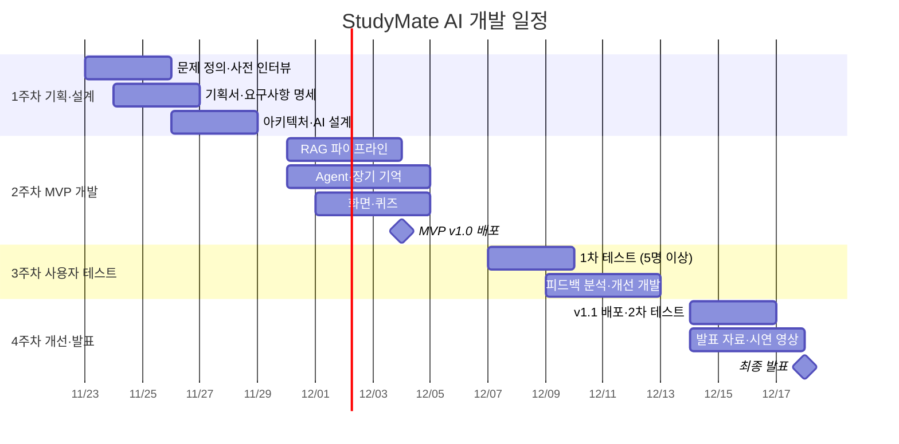

# 01. 프로젝트 기획서 — StudyMate AI

> 내 공부 자료로 질문하고, 퀴즈 풀고, 약점까지 기억하는 AI 학습 튜터

| 항목 | 내용 |
|---|---|
| 서비스명 | StudyMate AI (스터디메이트) |
| 한 줄 소개 | 사용자가 올린 강의자료·필기를 근거로 답하고(RAG), 퀴즈로 약점을 찾아 기억했다가(Long-term Memory), 다음 학습에서 먼저 챙겨 주는 AI 튜터 Agent |
| 핵심 기술 | AI Agent(Function Calling) · RAG · Long-term Memory · (확장) n8n 자동화 워크플로우 |
| 형태 | 웹 서비스 (PC·모바일 브라우저), Streamlit Community Cloud 배포 |
| 팀 | 5인 (3~4인 구성 시 역할 통합안은 7장 참고) |

---

## 1. 문제 정의

### 1-1. 배경
- 대학 강의, 자격증, 부트캠프 등 **공부 자료(PDF·필기)는 계속 쌓이지만**, 공부하다 막힐 때 **내 자료 기준으로** 바로 물어볼 곳이 없다.
- 범용 AI 챗봇에 물어보면 답은 빠르지만 **내 수업 범위·교재 표현과 다르게** 답하거나, 그럴듯하지만 틀린 내용(환각)을 섞는다. 출처가 없어 맞는지 확인하기도 어렵다.
- 범용 챗봇은 **어제 내가 뭘 틀렸는지 기억하지 못한다.** 같은 개념을 반복해서 틀리고, 무엇을 복습해야 할지 스스로 관리해야 한다.

### 1-2. 문제 진술
> **"자기 자료로 공부하는 학습자는 막히는 개념을 자료 근거로 빠르게 확인하고, 자신이 반복해서 틀리는 개념을 관리할 방법이 없어 복습 효율이 떨어진다."**

### 1-3. 해결 질문 (How Might We)
- 어떻게 하면 학습자가 **자기 자료를 근거로, 출처까지 확인 가능한** 답을 바로 얻을 수 있을까?
- 어떻게 하면 AI가 학습자의 **목표·선호·약점을 기억**해서, 다음 학습에서 먼저 챙겨 줄 수 있을까?

### 1-4. 가설과 검증 방법
| # | 가설 | 검증 지표 (사용자 테스트) | 목표 |
|---|---|---|---|
| H1 | 출처가 붙은 자료 기반 답변은 범용 챗봇보다 신뢰도가 높다 | 답변 👍 비율, 설문 "도움이 됐나요" | 👍 70% 이상, 4.0/5 이상 |
| H2 | 퀴즈 → 약점 기억 → 재설명 루프는 복습에 도움이 된다 | 퀴즈 응시자 중 '틀린 개념 다시 배우기' 사용 비율, 인터뷰 | 50% 이상 사용 |
| H3 | 장기 기억(선호·목표)을 반영한 답변은 개인화됐다고 느낀다 | 설문 만족도, 인터뷰 "나를 기억한다고 느꼈나" | 테스터 과반 긍정 |
| H4 | 처음 쓰는 사람도 3분 안에 첫 질문까지 갈 수 있다 | 관찰 테스트 소요 시간, 사용 편의성 점수 | 4.0/5 이상 |

> 위 목표치는 팀이 정한 **기준선**이며, 실제 결과는 사용자 테스트 후 `05_사용자_테스트_계획.md`의 결과 양식에 기록한다.

---

## 2. 타겟 사용자

### 2-1. 1차 타겟
**자기 자료(강의 PDF·필기)로 시험·자격증을 준비하는 대학생·취업 준비생**
- 강의자료가 PDF로 주어지고, 시험 범위가 정해져 있다.
- 혼자 공부하는 시간이 많고, 모르는 걸 물어볼 사람이 즉시 없다.

### 2-2. 2차 타겟
**부트캠프·온라인 교육과정 수강생** (예: 코디세이 과정 동료)
- 학습 노트를 마크다운으로 정리하는 경우가 많다 → TXT·MD 업로드 지원
- **사용자 테스트 모집이 가장 쉬운 집단** → 5명 이상 테스트 조건을 확실히 충족

### 2-3. 가상 페르소나 (설계용 가정)
| | 페르소나 A — 지민 (23, 대학교 3학년) | 페르소나 B — 현우 (28, 부트캠프 수강생) |
|---|---|---|
| 상황 | 데이터베이스 중간고사 2주 전, 교수님 PDF 12개 | AI 과정 수강 중, 매일 마크다운으로 학습 노트 정리 |
| 불편 | 챗봇 답이 교재 용어와 달라 헷갈림. 정규화를 계속 틀림 | 노트가 쌓이기만 하고 다시 보지 않음. 뭘 복습할지 모름 |
| 원하는 것 | "교수님 자료 기준으로, 몇 페이지에 나오는지까지" | "내가 약한 걸 알아서 퀴즈로 내 줬으면" |
| 핵심 기능 | 자료 기반 Q&A + 출처 | 약점 기억 + 약점 집중 퀴즈 |

---

## 3. 해결 방안 — 서비스 핵심 흐름

```
① 자료 올리기  →  ② AI 튜터에게 질문  →  ③ 퀴즈로 확인  →  ④ 약점 기억  →  ⑤ 다음 대화에서 먼저 챙김
   (PDF/TXT/MD)     (자료 근거 + 출처)      (자료 기반 객관식)   (장기 기억 자동 갱신)   (개인화 설명·재출제)
```

| 핵심 기능 | 설명 | 사용자 가치 |
|---|---|---|
| 자료 기반 AI 튜터 | 질문하면 Agent가 자료를 검색해 근거와 출처([S1] 파일명 p.3)를 붙여 답함 | 믿을 수 있는 답, 원문 확인 가능 |
| 자료 기반 퀴즈 | 범위·주제·난이도·문항 수를 골라 객관식 퀴즈 생성, 채점·해설·근거 제공 | 이해했는지 바로 확인 |
| 약점 기억 | 틀린 개념은 약점으로, 다시 맞히면 강점으로 자동 전환 | 복습 대상을 AI가 관리 |
| 개인화 | 목표·시험 일정·선호하는 설명 방식을 기억해 답변에 반영 | "나를 아는" 튜터 |
| 학습 기록 | 기억 목록, 퀴즈 정답률 추이, 데이터 직접 관리(삭제) | 성장 확인, 통제권 |

---

## 4. AI 활용 방식

| 필수 기술 요소 | 적용 여부 | 서비스 내 역할 | 구현 파일 |
|---|---|---|---|
| **AI Agent** | ✅ 핵심 | 사용자 의도를 파악해 3개 도구(자료 검색·학습 기록 조회·기억 저장)를 스스로 선택·호출하고 결과를 종합해 답변 | `studymate/agent.py` |
| **RAG** | ✅ 핵심 | 업로드 자료를 청크·임베딩해 저장, 질문과 유사한 청크를 검색해 근거로 사용, 출처 표시 | `studymate/rag.py`, `documents.py` |
| **Long-term Memory** | ✅ 핵심 | 목표·선호·약점·강점을 DB에 저장, 매 대화 시스템 프롬프트에 자동 주입, 퀴즈 결과로 자동 갱신 | `studymate/memory.py` |
| 자동화 워크플로우 | ✅ 확장 | 피드백 제출 → n8n Webhook → Google Sheets 기록 + Discord 팀 알림 | `automation/` |
| 멀티모달 AI | ➖ 미적용 | 향후: 스캔 PDF·손글씨 노트 이미지 인식(OCR) | — |

→ **필수 2개 이상 조건 대비 핵심 3개 + 확장 1개 적용.** 상세 설계는 `03_AI_설계서.md`.

---

## 5. 기술적 접근 방식

| 영역 | 선택 | 한 줄 이유 (상세: `04_기술스택_및_의사결정.md`) |
|---|---|---|
| 언어 | Python 3.12 | 과정에서 학습한 언어, AI 라이브러리 생태계 |
| 화면 + 서버 | Streamlit | Python만으로 채팅·업로드·차트 UI까지, 배포가 가장 쉬움 |
| LLM | OpenAI `gpt-5.4-mini` | 도구 호출·JSON 출력 지원, 저렴한 비용 |
| 임베딩 | OpenAI `text-embedding-3-small` | 한국어 의미 검색 품질 대비 매우 저렴 |
| Agent | OpenAI Function Calling 직접 구현 | 프레임워크 없이 동작 원리를 설명 가능, 의존성 최소화 |
| 벡터 검색 | DB 저장 + numpy 코사인 유사도 | 사용자당 자료 규모가 작아 별도 Vector DB 불필요 |
| DB | Supabase PostgreSQL (로컬은 SQLite) | 무료, 배포 환경에서 데이터 영구 보존 |
| 배포 | Streamlit Community Cloud | GitHub 연동만으로 무료 배포, push 시 자동 재배포 |
| 자동화 | n8n | 노코드로 시트 기록·팀 알림 파이프라인 구성 |
| 품질 | pytest 57개 + GitHub Actions CI | 가짜 LLM으로 API 비용 없이 전체 흐름 검증 |

---

## 6. 차별점

| 비교 대상 | 한계 | StudyMate AI |
|---|---|---|
| 범용 AI 챗봇 | 내 자료 범위를 모름, 출처 없음, 지난 학습을 기억하지 않음 | 내 자료만 근거로, 출처 표시, 약점·목표를 기억 |
| 문서 Q&A 도구 | 문서 질의응답 중심 | **질문 → 퀴즈 → 약점 기억 → 재설명**으로 이어지는 학습 루프 |
| 일반 퀴즈 앱 | 문제를 직접 만들어야 함 | 내 자료로 AI가 출제, 오답이 자동으로 다음 학습에 반영 |

---

## 7. 팀 구성 및 역할 (5인 기준)

| 역할 | 담당 업무 | 주 담당 산출물 / 코드 |
|---|---|---|
| **PM / 기획** | 일정·이슈 관리, 문제 정의·인터뷰, 사용자 테스트 총괄, 발표 | 기획서, 테스트 계획·결과, 발표 자료, GitHub Projects 보드 |
| **AI Engineer (Agent)** | Agent 루프·도구 설계, 프롬프트 엔지니어링, 장기 기억 | `agent.py`, `prompts.py`, `memory.py`, AI 설계서 |
| **RAG / Data Engineer** | 문서 파싱·청크·임베딩·검색, 퀴즈 생성, 검색 품질 평가 | `documents.py`, `rag.py`, `quiz.py` |
| **Frontend / UX** | Streamlit 화면, 사용 흐름·문구, 피드백·관리자 화면 | `app.py`, `texts.py`, 화면 설계 |
| **DevOps / QA** | DB·배포·Secrets, CI·테스트, n8n 자동화, 개인정보 보호 | `db.py`, `analytics.py`, `tests/`, `.github/`, `automation/` |

- **모든 팀원이 코드 1개 이상 + 문서 1개 이상을 담당**하고, 본인 이름으로 PR을 올려 기여 기록을 남긴다.
- 3인 팀: PM+Frontend / AI+RAG / DevOps+QA · 4인 팀: PM / AI / RAG / Frontend+DevOps
- 개인 진행 시: 같은 산출물을 모두 수행하되, 일정의 테스트 기간을 우선 확보한다.

---

## 8. 일정 계획 (4주)

> 예시 날짜는 2026-11-23(월) 시작 기준. 실제 과정 일정에 맞춰 조정한다.



| 주차 | 목표 | 주요 작업 | 완료 기준 (마일스톤) |
|---|---|---|---|
| 1주차 (11/23~11/29) | 기획 확정 | 사전 인터뷰 3명 이상, 기획서·요구사항 명세·AI 설계서, 저장소·보드 세팅 | 문서 01~04 merge |
| 2주차 (11/30~12/06) | MVP 배포 | 자료 업로드·RAG, Agent·기억, 퀴즈, 피드백 화면, 테스트·CI, Supabase·배포 | **M1: 외부 URL 접속 가능 (v1.0.0)** |
| 3주차 (12/07~12/13) | 1차 사용자 테스트 | 테스터 5명 이상 모집·진행, 설문·통계 분석, 개선 우선순위, 개선 개발 | 테스트 결과 문서, 개선 이슈 등록 |
| 4주차 (12/14~12/20) | 개선 검증·발표 | v1.1.0 배포, 2차 테스트(버전별 만족도 비교), 발표 자료·시연 영상, README 정리 | **M2: 최종 발표** |

---

## 9. 성공 지표 (KPI)

| 구분 | 지표 | 목표 | 측정 위치 |
|---|---|---|---|
| 필수 | 실사용 테스터 수 | 5명 이상 (목표 8명) | 관리자 화면 '실사용자' |
| 품질 | 답변 👍 비율 | 70% 이상 | 관리자 화면 '👍 비율' |
| 만족 | 평균 만족도 | 4.0 / 5 이상 | 피드백 통계 |
| 개선 | v1.0 → v1.1 만족도 변화 | 상승 | 관리자 '버전별 피드백 평균' |
| 학습 | 1인당 퀴즈 응시 | 2회 이상 | 퀴즈 기록 |

---

## 10. 리스크 및 대응

| 리스크 | 영향 | 대응 |
|---|---|---|
| AI 환각 | 신뢰도 하락 | 자료 근거 강제·출처 표시·"자료에 없음" 명시·(일반 지식) 표시, 👎 답변 분석 |
| API 비용 증가 | 예산 초과 | 저가 모델, 1인 일일 질문 한도(100), 문서 수·크기 제한, OpenAI 사용 한도 설정 |
| 스캔 PDF 등 텍스트 추출 실패 | 자료 등록 불가 | 명확한 오류 안내, TXT/MD 대안, 샘플 자료 제공 / 향후 OCR(멀티모달) |
| 무료 배포 환경 잠자기·재시작 | 데이터 유실, 첫 접속 지연 | DB를 Supabase로 분리해 영구 보존, 테스트 기간 중 매일 접속 확인 |
| 테스터 모집 부족 | 필수 요건 미충족 | 과정 동료·스터디 그룹 우선 모집, 샘플 자료로 자료 없는 사람도 체험 가능 |
| 개인정보 노출 | 윤리·법적 문제 | 실명·연락처 미수집, 자동 마스킹, 동의·삭제 기능, 외부 전송 시 익명 ID |

---

## 11. AI 윤리 원칙
1. **AI 생성 콘텐츠 명시** — 첫 화면, 모든 답변·퀴즈 하단에 "AI가 생성한 내용" 표시
2. **근거와 한계 공개** — 출처 표시, 자료에 없는 내용은 밝히고 일반 지식은 구분 표시
3. **개인정보 최소 수집·동의** — 닉네임·PIN만으로 식별, 가입 시 동의 필수, 국외 이전(OpenAI) 고지
4. **사용자 통제권** — 기억 개별 삭제, 대화 삭제, 계정·데이터 전체 삭제
5. **안전한 저장** — PIN 해시, 비밀 키는 Secrets로만 관리, 피드백 외부 전송 시 익명 ID
