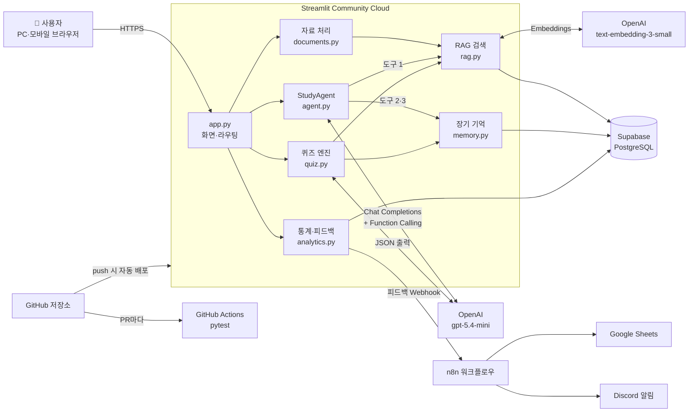
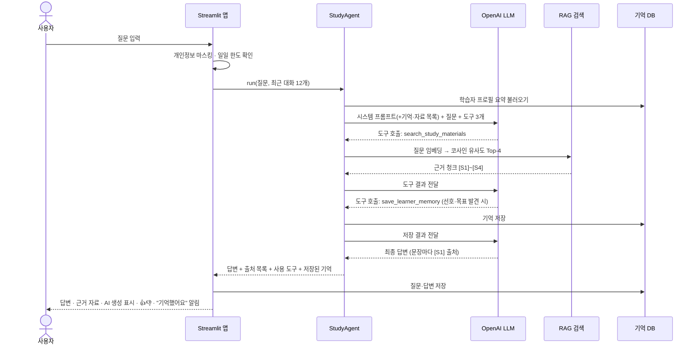
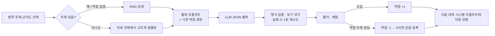
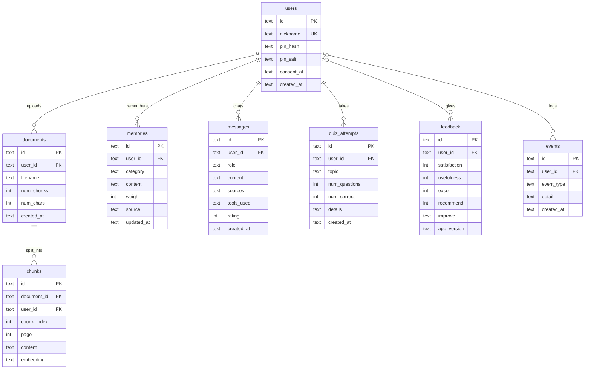

# 02. 기능 요구 명세서 · 시스템 아키텍처

## 1. 개요
- **프로젝트명**: StudyMate AI — 내 공부 자료 기반 AI 학습 튜터
- **목적**: 자기 자료로 공부하는 학습자가 자료 근거로 질문하고, 퀴즈로 약점을 찾고, AI가 약점·목표를 기억해 다음 학습을 이어가도록 돕는다.
- **대상 사용자**: 시험·자격증을 준비하는 대학생·취업 준비생, 교육과정 수강생
- **우선순위 기준**: Must(없으면 서비스 성립 안 됨) / Should(핵심 가치 강화) / Could(여유 시 구현)

---

## 2. 기능 요구사항 (Functional Requirements)

| ID | 기능명 | 설명 | 우선순위 | 구현 위치 | 상태 |
|---|---|---|---|---|---|
| FR-01 | 사용자 식별 | 닉네임(2~20자) + PIN(숫자 4~6자리)으로 가입·로그인. 실명·이메일 미수집 | Must | `auth.py`, `app.py` 로그인 | ✅ |
| FR-02 | 개인정보 동의 | 가입 시 수집 항목·목적·보관 기간·국외 이전 고지, 동의 체크 없으면 가입 불가 | Must | `texts.py`, `auth.register` | ✅ |
| FR-03 | 자료 업로드 | PDF·TXT·MD 다중 업로드, 파일당 10MB, 사용자당 10개 제한, 중복 파일명 차단 | Must | `app.py` 내 자료 | ✅ |
| FR-04 | 자료 인덱싱 | 텍스트 추출(페이지 보존) → 개인정보 마스킹 → 청크(800자/겹침 150자) → 임베딩 → DB 저장 | Must | `documents.py`, `rag.ingest_document` | ✅ |
| FR-05 | 자료 관리 | 등록 자료 목록(조각 수·글자 수·등록일), 개별 삭제 | Must | `rag.list/delete_document` | ✅ |
| FR-06 | AI 튜터 채팅 | 질문 입력 → Agent가 도구를 선택·호출해 답변. 최근 대화 12개로 맥락 유지 | Must | `agent.py` | ✅ |
| FR-07 | 근거·출처 표시 | 답변 문장에 [S1] 출처 번호, '근거 자료' 펼침에 파일명·페이지·유사도·원문 일부 | Must | `agent._tool_search`, `render_message` | ✅ |
| FR-08 | 기억 자동 저장 | 대화 중 목표·선호·약점·강점을 Agent가 판단해 저장, 저장 시 알림 | Must | `save_learner_memory` 도구 | ✅ |
| FR-09 | 기억 자동 로드 | 매 대화 시작 시 학습자 프로필 요약(최대 15줄)을 시스템 프롬프트에 주입 | Must | `memory.build_memory_block` | ✅ |
| FR-10 | 대화 기록 유지 | 대화를 DB에 저장, 재접속 시 최근 50개 복원 | Must | `memory.save/load_messages` | ✅ |
| FR-11 | 퀴즈 생성 | 범위(전체/특정 자료)·주제 키워드·난이도(3단계)·문항 수(3~10) 선택, 자료 기반 객관식 4지선다 생성 | Must | `quiz.generate_quiz` | ✅ |
| FR-12 | 채점·해설 | 미응답 방지, 점수·정답률, 문항별 정답·해설·근거 자료 표시 | Must | `quiz.grade`, `render_quiz_body` | ✅ |
| FR-13 | 약점·강점 자동 갱신 | 오답 주제 → 약점(+1), 약점 주제 정답 → -1, 0이 되면 약점 해제 + 강점 등록 | Must | `memory.update_topic_from_quiz` | ✅ |
| FR-14 | 약점 집중 퀴즈 | 기록된 약점 주제로 검색해 출제 | Should | `generate_quiz(focus_weak=True)` | ✅ |
| FR-15 | 틀린 개념 재학습 | 채점 후 버튼 한 번으로 틀린 개념 질문을 AI 튜터에 전달 | Should | `ask_tutor` | ✅ |
| FR-16 | 학습 기록 대시보드 | 자료·질문·퀴즈 수, 평균 정답률, 정답률 추이 차트, 퀴즈 이력 표 | Should | `render_memory` | ✅ |
| FR-17 | 기억 직접 관리 | AI가 기억한 내용 확인·개별 삭제·직접 추가 | Should | `render_memory` | ✅ |
| FR-18 | 데이터 삭제 | 대화 기록 삭제, 계정 및 모든 데이터 삭제(피드백은 익명화) | Must | `db.delete_user_data` | ✅ |
| FR-19 | 답변 평가 | 답변마다 👍/👎 평가 저장 | Must | `st.feedback`, `memory.rate_message` | ✅ |
| FR-20 | 피드백 설문 | 만족도·유용성·편의성(1~5), 추천 의향(0~10), 좋았던 점·개선점, 사용자 유형, 앱 버전 자동 기록 | Must | `render_feedback`, `analytics.save_feedback` | ✅ |
| FR-21 | 관리자 현황 | 가입·실사용자·질문·퀴즈·👍 비율·피드백 통계, 버전별 만족도, 일별 활동, 피드백 CSV, 👎 답변 목록 | Should | `render_admin`, `analytics.py` | ✅ |
| FR-22 | 샘플 자료 체험 | 자료가 없는 테스터도 버튼 한 번으로 'AI 기초 개념 노트' 등록 | Should | `sample_data/` | ✅ |
| FR-23 | 자동화 워크플로우 | 피드백 제출 시 n8n Webhook 호출 → Google Sheets 기록 + Discord 알림 | Could | `analytics.send_webhook`, `automation/` | ✅ |
| FR-24 | 추천 질문 | 첫 대화 화면에 예시 질문 버튼 3개 | Could | `SUGGESTED_PROMPTS` | ✅ |

---

## 3. 비기능 요구사항 (Non-Functional Requirements)

| ID | 항목 | 요구사항 | 구현·검증 방법 |
|---|---|---|---|
| NFR-01 | 응답 속도 | 채팅 답변 평균 10초 이내, 10쪽 PDF 등록 30초 이내 | 추론 강도 `low`, 임베딩 64개 배치, 사용자별 인덱스 메모리 캐시. 테스트 기간에 실측해 기록 |
| NFR-02 | 정확성·신뢰성 | 학습 질문은 자료 검색 후 답변, 근거 없는 내용은 "자료에 없음"·"(일반 지식)" 표시 | 시스템 프롬프트 규칙 1·2, 검색 최소 유사도 0.2, 👎 답변 분석 |
| NFR-03 | 안정성 | 도구 무한 호출 방지, 도구 오류·잘못된 인자에도 답변 생성, 퀴즈 형식 오류 시 1회 재시도 | `MAX_TOOL_STEPS=5`, 오류를 LLM에 전달, `parse_quiz` 검증 (테스트로 검증) |
| NFR-04 | 데이터 영속성 | 배포 서버가 재시작돼도 데이터 보존 | 배포 시 `DATABASE_URL`=Supabase PostgreSQL |
| NFR-05 | 보안 | PIN은 PBKDF2-SHA256(20만 회)+솔트 해시, API 키는 Secrets로만 관리, 로그인 5회 실패 시 차단, 관리자 비밀번호 | `auth.py`, `.gitignore`, `secrets.toml` |
| NFR-06 | 개인정보 보호 | 최소 수집, 자료·질문·피드백 속 전화번호·이메일·주민번호 자동 마스킹, 외부 전송 시 익명 ID, 삭제권 보장 | `mask_pii`, `anonymous_id`, `delete_user_data` |
| NFR-07 | 비용 통제 | 1인 하루 질문 100회, 자료 10개·파일 10MB·문서당 400조각 제한, 저가 모델 | `DAILY_MESSAGE_LIMIT` 등 설정값 |
| NFR-08 | 사용성 | 처음 방문자가 3분 안에 첫 질문, 모바일 브라우저 사용 가능, 모든 오류는 한국어 안내 | 샘플 자료·추천 질문, Streamlit 반응형, `_friendly()` 오류 문구 |
| NFR-09 | 투명성(AI 윤리) | 모든 AI 출력에 AI 생성 표시, 사용한 도구 표시 | `AI_NOTICE_SHORT`, 답변 하단 캡션 |
| NFR-10 | 유지보수성 | 기능별 모듈 분리, 자동 테스트, PR마다 CI | `studymate/` 패키지, pytest 57개, GitHub Actions |
| NFR-11 | 이식성 | 모델·API 제공사·DB를 코드 수정 없이 교체 | `CHAT_MODEL`, `OPENAI_BASE_URL`, `DATABASE_URL` |
| NFR-12 | 가용성 | 테스트 기간 중 서비스 접속 가능 (무료 플랜 특성상 잠자기 후 첫 접속은 지연 가능) | 매일 접속 점검, 장애 시 Discord 공지 |

---

## 4. AI 활용 명세

| 기능 | AI 활용 방식 | 입력 → 출력 | 상세 |
|---|---|---|---|
| AI 튜터 답변 | **AI Agent** (Function Calling) | 질문 + 기억 + 최근 대화 → 도구 호출 계획 → 답변 | 3개 도구 중 필요 도구를 LLM이 선택, 최대 5단계 |
| 자료 근거 검색 | **RAG** (임베딩 + 코사인 유사도) | 질문 → Top-4 청크 [S1]~[S4] | `text-embedding-3-small`, 사용자별 격리 검색 |
| 개인화 | **Long-term Memory** | 기억 DB → 시스템 프롬프트 주입 / 대화·퀴즈 → 기억 저장 | 목표·선호·약점·강점·기타 5종, 가중치·중복 병합 |
| 퀴즈 출제 | LLM + RAG + JSON 출력 | 근거 청크 + 기존 약점 표현 → 문제 JSON | 형식 검증, 보기 섞기(정답 위치 편향 제거), 재시도 |
| 약점 관리 | Memory 규칙 엔진 | 채점 결과 → 약점/강점 갱신 | 퀴즈 topic 기준 자동 갱신 |
| 피드백 파이프라인 | **자동화 워크플로우** (n8n) | 피드백 → Webhook → 시트·알림 | 노코드 + Python 연동 |

---

## 5. 시스템 아키텍처

### 5-1. 구성도

### 5-2. 구성 요소

| 구성 요소 | 역할 | 기술 |
|---|---|---|
| 화면 (`app.py`) | 로그인·동의, 5개 메뉴(튜터·자료·퀴즈·기록·피드백) + 관리자 | Streamlit |
| Agent (`agent.py`) | 도구 호출 루프, 출처 번호 관리, 인용 여부 판정 | OpenAI Function Calling |
| 자료 처리 (`documents.py`) | PDF/TXT/MD 추출, 인코딩 처리(UTF-8·CP949), 마스킹, 청크 | pypdf, 정규식 |
| RAG (`rag.py`) | 임베딩 저장(base64 float32), 사용자별 인덱스 캐시, 코사인 검색, 샘플링 | numpy |
| 장기 기억 (`memory.py`) | 기억 CRUD·중복 병합·상한, 퀴즈 결과 반영, 프로필 요약, 대화 기록 | SQL |
| 퀴즈 (`quiz.py`) | 출제 프롬프트, JSON 파싱·검증·보기 섞기, 채점 | OpenAI JSON 모드 |
| 통계 (`analytics.py`) | 이벤트 로그, 일일 한도, 피드백 저장·Webhook, 관리자 통계 | SQL, requests |
| DB (`db.py`) | SQLite/PostgreSQL 공용 접근 계층, 스키마, 사용자 데이터 삭제 | sqlite3, psycopg2 |

### 5-3. 질문 처리 흐름 (Agent + RAG + Memory)

### 5-4. 퀴즈 → 장기 기억 흐름

---

## 6. 데이터 모델

- `memories.category`: `goal`(목표) · `preference`(선호) · `weak_topic`(약점) · `strength`(강점) · `fact`(기타)
- `memories.source`: `agent`(대화 중 저장) · `quiz`(퀴즈 결과) · `user`(직접 입력)
- `events.event_type`: `signup`, `login`, `upload`, `chat`, `rate`, `quiz_generate`, `quiz_submit`, `feedback`, `error`, `delete_document`

---

## 7. 화면 구성

| 화면 | 주요 요소 | 관련 FR |
|---|---|---|
| 첫 화면 | 서비스 소개 3단계, AI 생성 고지, 가입(닉네임·PIN·동의) / 로그인 | FR-01, 02 |
| 💬 AI 튜터 | 대화 기록, 추천 질문, 답변 + 근거 자료 + 사용 도구 + AI 표시 + 👍👎 | FR-06~10, 19, 24 |
| 📚 내 자료 | 개인정보 주의 안내, 다중 업로드, 샘플 자료, 자료 목록·삭제 | FR-03~05, 22 |
| 📝 퀴즈 | 출제 설정, 풀이, 점수, 약점·극복 알림, 해설·근거, 다시 배우기 | FR-11~15 |
| 🧠 학습 기록 | 지표 4개, AI가 기억한 나(삭제·추가), 정답률 차트, 데이터 삭제 | FR-16~18 |
| 🗣️ 피드백 | 설문 6문항, Google Form 링크(선택) | FR-20, 23 |
| 🔧 관리자 | 테스트 현황 지표, 버전별 만족도, 일별 활동, 피드백 CSV, 👎 답변 | FR-21 |
